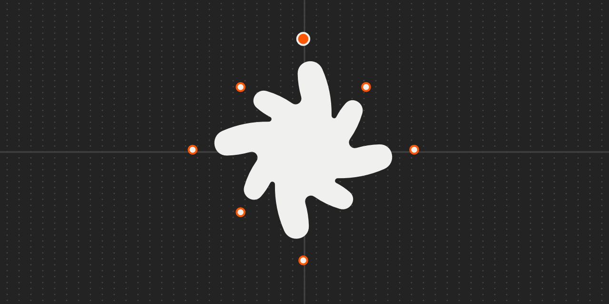

<p align="center">
  
</p>

# Rayform

Interactive SVG shape generator for stars, starbursts, badges, gears and other radial shapes, with a live preview. Tweak points, radii, rounded corners, curved edges, per-beam edits and animation, then copy or download clean, standalone SVG.

**Live app:** https://rotesbeats.github.io/Rayform/

<!-- Add a screenshot: save it as docs/screenshot.png and uncomment the line below -->
<!--  -->

## Features

**Shape**
- 3 to 32 points, outer and inner radius, rotation and skew/twist for pinwheel and sawblade looks
- Real rounded corners: tips and valleys are calculated as true arcs in the path, so they stay rounded without a stroke
- Edge curve, from pinched (sparkle) to puffy, that works together with corner rounding
- Secondary beams: set a different length for every 2nd to 8th beam, or pick individual beams by hand

**Per-beam editing**
- Select any beam and change its length, angle offset and tip rounding
- Drag the tip handles on the preview to stretch a beam directly
- Symmetry lock with mirror and radial modes

**Workflow**
- Five presets and a randomize button
- Undo and redo (slider drags count as a single step)
- Favorites gallery, saved in your browser
- Dark, light and transparent preview backgrounds; the star color follows the background unless you choose one

**Animation preview**
- Spin, Pulse, Twist, Ripple, Breathe, Sway, Soften, Bloom and Flutter, with speed and intensity sliders
- Preview only: the exported SVG is always the static shape

**Export**
- **SVG:** copy the code or download a `.svg` file with a tightly fitted `viewBox` and no background
- **WebM video:** record the animation you are previewing and download it as a looping `.webm` file
  - Pick a size of 480, 720 or 1080 px, then click **Record .WEBM**
  - Records a seamless loop of about 5 seconds, using your current shape, color, speed and intensity (never longer than 20 seconds)
  - Choose the **Transparent** preview background to get a WebM with a transparent background; Dark and Light record with a solid background
  - Recording runs in real time in your browser, so keep the tab open and in the foreground until it finishes
  - Works in Chrome, Edge and Firefox. Safari can't record WebM, and it ignores transparency when playing WebM files
 
[rayform-6pt-pulse.webm](https://github.com/user-attachments/assets/429ee7ae-06a9-4910-a8a0-852cc50b1bd6)
[rayform-8pt-twist.webm](https://github.com/user-attachments/assets/0ac68553-2bed-4153-9462-b5ff7ee2e17e)
[rayform-10pt-soften.webm](https://github.com/user-attachments/assets/08cf9048-8909-4735-bbc5-c296500b310c)
[rayform-12pt-ripple.webm](https://github.com/user-attachments/assets/917e5cc5-ca5c-461c-affd-be1969e5e78e)


## Keyboard shortcuts

| Key | Action |
| --- | --- |
| `R` | Randomize |
| `S` | Save to favorites |
| `C` | Copy SVG code |
| `D` | Download .SVG |
| `1` – `5` | Load preset |
| `[` `]` | Fewer / more points |
| `←` `→` | Rotate −5° / +5° |
| `P` | Play / pause animation |
| `B` | Cycle preview background |
| `H` | Show / hide selection points |
| `L` | Symmetry lock on / off |
| `Ctrl/⌘ Z` | Undo |
| `Shift+Ctrl/⌘ Z` or `Ctrl/⌘ Y` | Redo |
| `?` | Show the shortcut list |

Shortcuts pause while you are typing in a field.

## Run it locally

You need [Node.js](https://nodejs.org) (LTS).

```bash
git clone https://github.com/YOUR-USERNAME/rayform.git
cd rayform
npm install
npm run dev
```

Then open the address Vite prints (usually http://localhost:5173).

Other scripts:

```bash
npm run build     # production build in dist/
npm run preview   # preview the production build
```

## Built with

- [React](https://react.dev) and [Vite](https://vite.dev)
- [Tailwind CSS](https://tailwindcss.com) for basic layout; the visual design is plain CSS inside the component
- [Oxlint](https://oxc.rs) for linting
- Fonts: Space Grotesk and Space Mono

## How the shapes work

The star is built from `2 × points` vertices that alternate between outer tips and inner valleys. Each corner is rounded by trimming the two edges that meet there and joining them with an arc, or with a cubic Bézier when edges are curved, so the join stays smooth. The SVG output is a single `<path>`.

## Deployment

Every push to `main` builds the app and publishes it to GitHub Pages through the workflow in `.github/workflows/deploy.yml`. In the repository settings, set **Pages → Source** to **GitHub Actions**.

## License

Rayform is source-available under the [PolyForm Noncommercial License 1.0.0](LICENSE).

- **Free** for personal use, learning, hobby projects, research, and use by charities, schools and other non-profit organizations.
- **Commercial use** (for example inside a paid product, a client project billed for, or a business) needs a separate license. Get in touch through my [GitHub profile](https://github.com/RotesBeats).
- **Your SVGs are yours.** Shapes you create and export with Rayform are free to use for any purpose, including commercial work. The license covers the source code, not the files you make with the app.

This repository is not currently accepting code contributions. Bug reports and ideas are welcome as issues.
